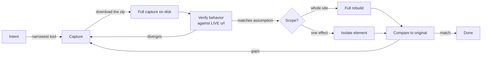

<div align="center">

# claude-enrichr-skill

**A Claude Code skill that turns the [Enrichr](https://enrichr.dev) MCP into a reliable site-cloning pipeline** — capture a live site's DOM, CSS, design tokens, GSAP/scroll animation, WebGL/shaders, SVG, 3D scene, and every asset; verify what's *actually* running; then rebuild the whole site or isolate a single effect, in Claude Code.


</div>

---

## Why this exists

The Enrichr MCP is powerful: it renders a page in a real browser and reports what actually happened — computed styles, motion measured by scrolling, shaders compiled on a real GPU, the 3D scene read out of the running renderer. But used naively it produces confident, wrong rebuilds. This skill is the accumulated "how to actually use it" — written from real cloning sessions where each of these mistakes cost real time:

- **Trusting the X-ray.** A capture shows what *exists* in a bundle, not what *fires* on the page. A shader with a `u_mouse` uniform is not proof of a mouse-follow effect — on one real site that exact assumption produced a fabricated WebGL background warp when the actual "mouse effect" was a pure-CSS button morph on hover. **The fix: verify behavior against the live URL before building.**
- **Stopping at the brief.** `rebuild_brief` returns a text summary, but the real capture — localized DOM, applied CSS, screenshots, shaders, glTF, analysis JSON — is in a downloadable zip. Read only the brief and you've thrown away most of what you paid for.
- **The silent 404.** A captured bundled SPA (Nuxt/Next/Vite) 404s on its own dynamic-import chunks when served locally, because Enrichr rewrites the HTML's asset URLs but not the `import()` specifiers inside the JS. The app's error boundary masks it as a vague hydration error.
- **The blank canvas.** A GLSL reserved word used as a variable (`patch`, `sample`, `filter`, …) fails the shader compile silently — no JS error, just nothing drawn.

This skill encodes the routing, the gotchas, the verification discipline, and the IP guardrails so a future Claude session gets it right the first time.

## The workflow



**Capture → Verify → Rebuild**, always in that order. The middle step is the one people skip and regret.

## What it captures — everything, mapped to a tool

| Layer | Tool / file | Notes |
|---|---|---|
| DOM & structure | `reverse_engineer_dom` · `original/rendered.html` | Post-JS, as it settled |
| Applied CSS | `rebuild_brief` · `styles/used.css` | Only the cascade that actually applied |
| Design tokens | `extract_design_system` | Colors, type scale, spacing, easings, breakpoints |
| Fonts | `extract_design_system` · `assets/fonts/` | ⚠️ licensed (Adobe/Typekit) fonts are not yours to self-host |
| GSAP / ScrollTrigger / Lenis / CSS motion | `reverse_engineer_animations` · `scroll-motion.json` | Motion is *measured*, so it survives even a minified bundle |
| Mouse follower / cursor effects | `interact_with_page` (live) | No static file — behavior only |
| Hover / focus / active states | `interaction-states.json` | What a resting screenshot can't show |
| WebGL / GLSL / 3D | `reverse_engineer_webgl` · `shaders/*.glsl` · `assets/3d/scene.gltf` | Live scene exported as glTF; textures pulled off the GPU |
| SVG (paths, masks, filters, morphs) | inline in `rendered.html` | Morphs = tween between path `d` values |
| Assets (img/video/font/model) | `extract_assets` · `assets/` | Deduped, network + DOM merged |
| Framework internals / data | `extract_site_profile` · `runtime.json` | `__NEXT_DATA__`, Nuxt payload, JSON-LD |
| Responsive | `responsive.json` · breakpoint screenshots | Per-breakpoint reflow |
| Canvas-only motion | `motion-frames/*.png` | Ordered stills; the only record when the DOM doesn't move |
| Pixel-baked text | `ocr_image` / `ocr_document` | Text in canvas/images/video the DOM can't see |

Full detail per subsystem is in [`references/capture-subsystems.md`](references/capture-subsystems.md).

## Rebuild the whole site — or isolate one element

Both start from the same capture; they differ in scope.

- **Whole site** — follow the capture's `REBUILD.md` order (tokens → structure → typography/assets → motion → 3D → behavior), serve locally, fix the known breakages, verify, and diff against the original.
- **Isolate one effect** — "I just want the cursor effect / the hero / that one animation." Find the element in `rendered.html`, slice its CSS/assets/motion track, and stand it up on a minimal host page as a drop-in.

Step-by-step for both — including how to isolate a mouse follower, a GSAP reveal, a WebGL background, or an SVG morph specifically — is in [`references/recreate-and-isolate.md`](references/recreate-and-isolate.md).

## Bundled scripts

| Script | What it does |
|---|---|
| [`scripts/fix_dynamic_imports.py`](scripts/fix_dynamic_imports.py) | Fixes the SPA dynamic-import 404s by creating bare-named copies of hashed JS chunks. Run against `site_capture/assets/js`. |
| [`scripts/extract_screenshots.py`](scripts/extract_screenshots.py) | Pulls base64 screenshots out of a saved (too-large-for-context) Enrichr result into real PNGs. |
| [`scripts/serve_capture.py`](scripts/serve_capture.py) | Runs the import fix, then serves the capture over HTTP for browser verification. |

All three are dependency-free (Python 3 stdlib) and verified against real captures.

## Installation

This repository **is** the skill folder. Clone it straight into your Claude Code skills directory:

```bash
# user-level (available in every project)
git clone https://github.com/chrisjeffries24/claude-enrichr-skill.git ~/.claude/skills/enrichr
```

```bash
# or project-level (available only in one project)
git clone https://github.com/chrisjeffries24/claude-enrichr-skill.git .claude/skills/enrichr
```

It requires the **Enrichr MCP** to be connected in your Claude client (the skill drives its tools). Once installed, Claude loads it automatically when you ask to clone / rebuild / reverse-engineer a site, or you can invoke it explicitly with `/enrichr`.

> **Note on paths:** the skill's `SKILL.md` refers to its scripts as `scripts/…`. If you install to a different location, the scripts are still in this repo's `scripts/` folder next to `SKILL.md`.

## How it pairs with the Enrichr MCP

The MCP is the *engine* — it does the browser rendering and measurement. This skill is the *operating manual*: it tells Claude which tool to reach for, how to pull the full capture rather than the summary, how to avoid the two silent breakages, and — most importantly — that a capture is evidence of what *exists*, not proof of what *runs*. The MCP without the skill is a box of powerful tools; with the skill it's a repeatable pipeline.

## Responsible use — reuse vs. reimplement

Cloning a site touches other people's work. The skill bakes in a guardrail table (see [`SKILL.md`](SKILL.md) §7). In short:

- ✅ **Safe to reuse:** design tokens (hex, type scale, spacing), short functional copy (button labels), layout structure.
- 🔁 **Reimplement, don't copy:** original shader/animation source, distinctive long-form copy.
- ⛔ **Don't redistribute:** licensed webfont binaries (Adobe/Typekit), brand imagery/logos unless the engagement clearly covers it.

Use this on sites you own or are authorized to work on. When in doubt, reimplement the *effect* rather than copying the *expression*.

## Repository layout

```
claude-enrichr-skill/
├── SKILL.md                          # the skill (loaded by Claude Code)
├── references/
│   ├── capture-subsystems.md         # every layer + which tool/file gives it
│   └── recreate-and-isolate.md       # whole-site & single-element workflows
├── scripts/
│   ├── fix_dynamic_imports.py
│   ├── extract_screenshots.py
│   └── serve_capture.py
├── README.md
└── LICENSE
```

## Contributing

Found another Enrichr gotcha, or a capture subsystem this doesn't cover? Open an issue or PR. The most valuable additions are **field lessons** — a concrete case where a naive capture led you wrong and how you caught it — since those are exactly what the skill exists to prevent.

## License

MIT — see [LICENSE](LICENSE). The skill's guidance and scripts are freely reusable. It does not bundle any captured site content; what you capture with it is your responsibility under the reuse guidance above.
